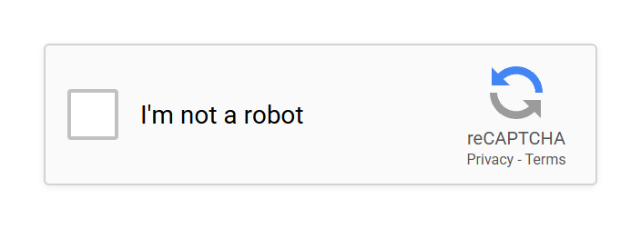
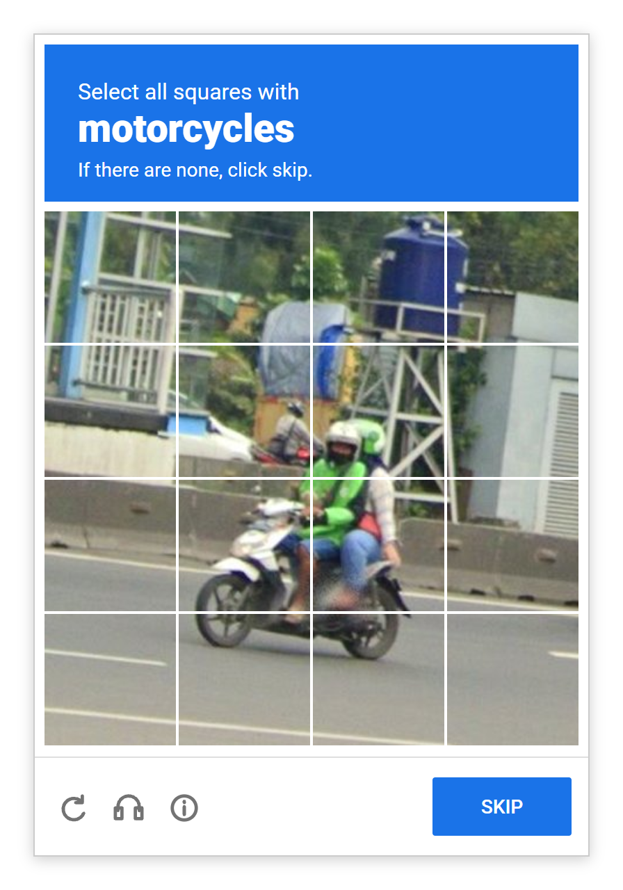
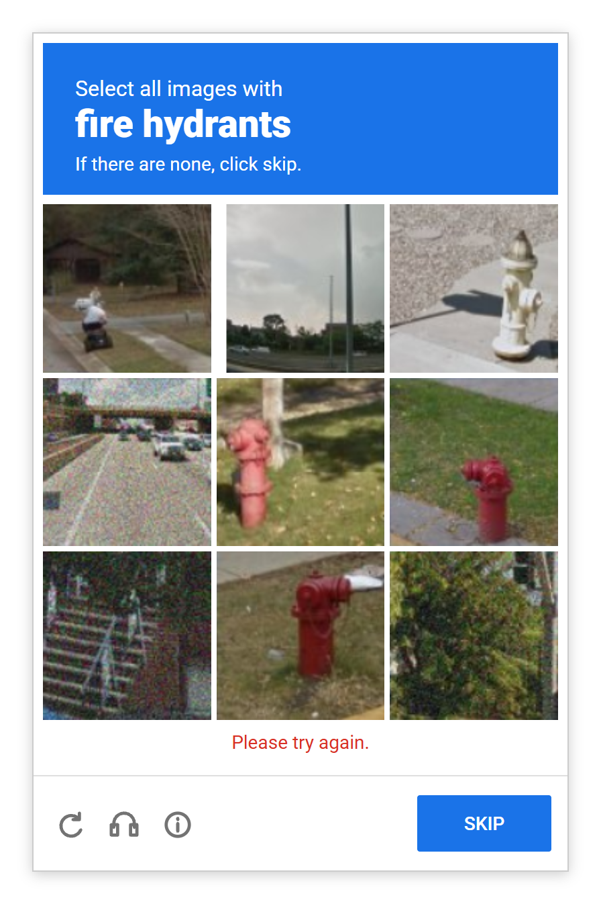

<div align="center">


# NeverCAPTCHA

**Just one quick check. Then another. Then another.**

An endless CAPTCHA parody built from real photo challenges. Every answer is wrong, every retry is another retry, and there is no finish line.

[](https://github.com/ztxv/neverCAPTCHA/actions/workflows/check.yml)


### [**▶ Try it live at nevercaptcha.vercel.app**](https://nevercaptcha.vercel.app/)

[Deploy your own](#deploy) &nbsp;·&nbsp; [Run it yourself](#run-it-yourself)

</div>

<p align="center">
  
</p>

<p align="center">
  
  &nbsp;&nbsp;
  
</p>

---

## About

You have clicked "I'm not a robot" a thousand times. NeverCAPTCHA is the version of that moment that never lets you through.

It looks and behaves like the image challenges everyone knows: pick the bicycles, find the fire hydrants, select every square with a traffic light. You will do it carefully. It will say *Please try again.* That is the whole joke, and it is executed with a straight face.

## Features

- **Real photos.** 120 genuine CAPTCHA tile photos and 19 full-scene street photos from public research datasets. Nothing is AI-generated.
- **Every challenge style.** 3×3 image grids, 4×4 split-scene grids, and dynamic rounds where selected tiles fade out and get replaced.
- **Endless by design.** Verification never succeeds, and dynamic rounds always keep at least one target on the board, so "click verify once there are none left" never comes true.
- **Audio challenge.** Switch to the headphones view and listen to spoken digits through the browser's speech synthesis. Your answer is also wrong.
- **Faithful details.** Selected-tile scaling, corner checkmarks, white gutters, two-second fade replacements, and the Skip/Verify button swap.
- **Accessible.** Keyboard operable, labelled grid squares, live error announcements, and a proper modal dialog.
- **Zero dependencies.** Plain HTML, CSS, and ES modules. No framework, no `npm install`, no API keys, no tracking, no backend.

## Deploy

NeverCAPTCHA is a static site, so it runs on any static host. The repository is preconfigured for Vercel through [`vercel.json`](vercel.json).

[](https://vercel.com/new/clone?repository-url=https%3A%2F%2Fgithub.com%2Fztxv%2FneverCAPTCHA&project-name=nevercaptcha&repository-name=nevercaptcha)

| Setting | Value |
| --- | --- |
| Framework preset | Other |
| Build command | `npm run build` |
| Output directory | `dist` |
| Environment variables | None |

For other hosts, run `npm run build` and upload the contents of `dist/`. The full walkthrough is in [docs/DEPLOYMENT.md](docs/DEPLOYMENT.md).

## How it works

```text
src/
  index.html            Checkbox widget and challenge dialog
  image-credits.html    Public photo attribution page
  js/
    engine.js           Round generation and dynamic tile replacement (pure, testable)
    app.js              DOM rendering, interaction, timing, and audio
    photos.js           Tile photo catalog by category
  styles/main.css       All interface styling
public/
  assets/
    photos/             120 tile photos (120×120)
    scenes/             19 full-scene photos (450×450)
    fonts/              Self-hosted Roboto
    icons/              Favicon and selection checkmark
  licenses/             Third-party license texts
scripts/                Dependency-free dev server, build, and checks
docs/                   Image provenance, manifest, deployment guide
```

Rounds cycle through ten challenge types. `engine.js` builds each round from the photo pools: static grids seed four targets among five distractors, split rounds slice one scene into sixteen squares, and dynamic rounds bias replacements toward new targets so the board never empties. `npm run check` replays 100 replacements per dynamic round and fails if a target ever disappears.

CI runs the same checks and a production build on every push and pull request.

## Run it yourself

Want to fork it or tinker? You only need [Node.js](https://nodejs.org/) 22+. There is nothing to install.

```sh
git clone https://github.com/ztxv/neverCAPTCHA.git
cd neverCAPTCHA
npm run dev
```

## Credits

- **Tile photos:** [hbcbh1999/recaptcha-dataset](https://github.com/hbcbh1999/recaptcha-dataset), MIT License.
- **Full-scene photos:** [ssivakorn/reCAPTCHA-study](https://github.com/ssivakorn/reCAPTCHA-study), CC BY-NC 4.0.
- **Font:** [Roboto](https://github.com/googlefonts/roboto-classic), SIL Open Font License 1.1.

Full license texts are in [`public/licenses/`](public/licenses), and every source URL is recorded in [`docs/image-manifest.json`](docs/image-manifest.json). Credits are also linked from the info panel inside the game.

> [!NOTE]
> The full-scene photos are licensed **CC BY-NC 4.0**, which prohibits commercial use. Review those terms before monetizing a deployment.

## Disclaimer

NeverCAPTCHA is an independent parody. It is not affiliated with, endorsed by, or connected to Google or reCAPTCHA. It does not load any real CAPTCHA service, collect answers, or solve or bypass any real access-control challenge.

<div align="center">
<sub>Built by <a href="https://github.com/ztxv">@ztxv</a> with <a href="https://github.com/codex">Codex</a>.</sub>
</div>
